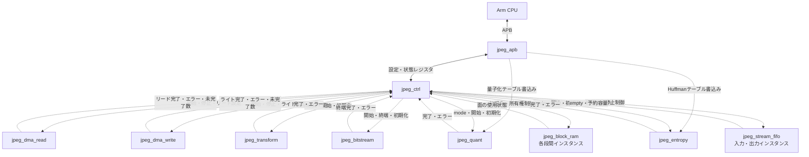

# 回路ブロック別設計仕様

更新日：2026-10-05

初回RTL実装の具体的な幅・レジスタ・テーブル・演算・停止手順は[RTL実装共通仕様](rtl_contract.md)に定義する。実装選択は参照モデルとサイクル評価で検証し、性能・画質の確定と区別する。

| 文書 | 対象 |
|---|---|
| [トップ](jpeg_top.md) | 接続・モード切替 |
| [jpeg_dma_read](jpeg_dma_read.md) | AXI4リード、画像読出し・端処理 |
| [jpeg_dma_write](jpeg_dma_write.md) | AXI4ライト、画像・JPEG書込み |
| [APB](jpeg_apb.md) | レジスタとテーブル設定 |
| [制御](jpeg_ctrl.md) | ジョブ・状態・停止 |
| [FIFO](jpeg_stream_fifo.md) | 入出力バッファと幅変換 |
| [ブロックRAM](jpeg_block_ram.md) | ブロック保持・zigzag |
| [DCT／IDCT](jpeg_transform.md) | 共有変換演算器 |
| [量子化](jpeg_quant.md) | 量子化・逆量子化 |
| [エントロピー](jpeg_entropy.md) | Huffman・DC・AC |
| [ビットストリーム](jpeg_bitstream.md) | ビットとバイトの変換 |

## ブロック間接続

実線はデータの進行方向、破線は設定・制御・状態の接続を示す。データ接続には逆方向のreadyによる停止制御が伴う。同名のブロックはモード間で共有し、入力／出力FIFOと段間RAMは用途別インスタンスとする。

### エンコードのデータ接続

```mermaid
flowchart LR
    MEM["DRAM"]
    subgraph TOP["jpeg_top：エンコード経路"]
        RD["jpeg_dma_read<br/>画像読出し"]
        WR["jpeg_dma_write<br/>JPEG書込み"]
        IN["jpeg_stream_fifo<br/>入力・幅変換"]
        PIX["jpeg_block_ram<br/>画素ブロック"]
        T["jpeg_transform<br/>DCT"]
        R1["jpeg_block_ram<br/>自然順係数"]
        Q["jpeg_quant<br/>量子化"]
        R2["jpeg_block_ram<br/>zigzag読出し"]
        E["jpeg_entropy<br/>DC・AC・Huffman"]
        B["jpeg_bitstream<br/>ビット蓄積・stuffing"]
        OUT["jpeg_stream_fifo<br/>出力・64bitパック"]
        RD -->|画素・64bit| IN
        IN -->|画素・記述子| PIX --> T
        T -->|自然順係数| R1 --> Q --> R2
        R2 -->|zigzag順係数| E
        E -->|符号語・長さ| B
        B -->|バイト列| OUT
        OUT -->|64bit・keep・last| WR
    end
    MEM -->|AXI4 R| RD
    WR -->|AXI4 W・B応答管理| MEM
```

### デコードのデータ接続

```mermaid
flowchart LR
    MEM["DRAM"]
    subgraph TOP["jpeg_top：デコード経路"]
        RD["jpeg_dma_read<br/>JPEG読出し"]
        WR["jpeg_dma_write<br/>画像書込み"]
        IN["jpeg_stream_fifo<br/>入力・バイト分解"]
        B["jpeg_bitstream<br/>stuffing除去・peek"]
        E["jpeg_entropy<br/>Huffman・DC復元・AC展開"]
        R2["jpeg_block_ram<br/>逆zigzag配置"]
        Q["jpeg_quant<br/>逆量子化"]
        R1["jpeg_block_ram<br/>自然順係数"]
        T["jpeg_transform<br/>IDCT"]
        PIX["jpeg_block_ram<br/>画素ブロック"]
        OUT["jpeg_stream_fifo<br/>出力・幅変換"]
        RD -->|64bit・keep・last| IN
        IN -->|バイト列| B
        B -->|peekビット・有効数| E
        E -.->|consume| B
        E -->|zigzag順係数| R2
        R2 -->|自然順係数| Q --> R1 --> T
        T -->|画素・記述子| PIX --> OUT
        OUT -->|画素行・64bit| WR
    end
    MEM -->|AXI4 R| RD
    WR -->|AXI4 W・B応答管理| MEM
```

### 設定・制御・状態の接続

jpeg_dma_readのブロック組立、変換器の転置RAM、各演算モジュールのテーブルRAMはそのモジュール内の機能。アドレスチャネル・応答などのAXI4詳細はDMA仕様に従う。図は論理接続を示し、各RAMのポート接続と調停はRTL実装時に具体化する。

## 共通接続規則

- 単一256 MHz、低有効同期リセット。modeはジョブ内で固定。
- valid/readyによる転送。停止中はvalidと全ペイロードを保持し、カウンタは転送成立時だけ更新する。
- DMA・FIFO間は64bit data、8bit keep、last。先行バイトは下位8bit。末尾のkeepは下位から連続する。lastはジョブの最終転送。
- 画素側はブロック記述子と64サンプル。記述子はcomponent（Y=0、Cb=1、Cr=2）、block_seq（32bit）、last_blockを含む。記述子とデータを対応付ける。
- 演算間は1係数／転送、index（0〜63）、component、last_block。符号付き係数幅COEF_W=32。indexは自然順かzigzag順かを各仕様に明記する。
- 成分順はY→Cb→Cr、MCU内のYブロックは行方向。4:4:4／4:2:2／4:2:0は設計案。初期は単一scan、Restartなし。
- busy中の設定・テーブル変更は禁止。エラーは最初の原因を保持し、全体制御へ通知する。

## 性能予算

A4・300 dpiの4:4:4はMCUが310 × 439、総ブロック数408,270。全体予算153,600,000 cycleから約376.2 cycle／ブロックとなる。初期の各主要段の処理開始間隔は256 cycle／ブロック以下を目標とする（約104.5 Mcycle／ページ）。段ごとの時間を単純に加算せず、RAM所有権と転送競合を含めて重ねられるかを検証する。

この目標はCPU・DMAを含む100 ppmの保証ではない。係数密度、符号長、メモリ待ちの影響はページ単位で測定する。

## 実装開始・引き継ぎ

新しいセッションは[実装引き継ぎ](../implementation_handoff.md)から開始する。読む順序、仕様の優先順位、実装手順と未検証事項を記載している。

## 共通参考資料

- [JPEG T.81](https://www.w3.org/Graphics/JPEG/itu-t81.pdf)：符号化と演算の規則。
- [Arm AXI仕様](https://developer.arm.com/-/media/Arm%20Developer%20Community/PDF/IHI0022H_amba_axi_protocol_spec.pdf)：転送・順序・境界条件。
