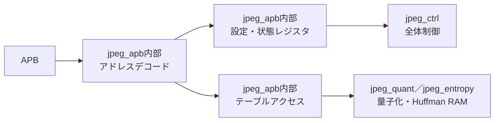

# jpeg_apb 設計仕様書

更新日：2026-10-05  
状態：初回RTL実装用（性能・画質は評価前）  
参照：[全体仕様](../design_spec.md)、[共通仕様](README.md)、[RTL実装共通仕様](rtl_contract.md)

図中の「内部」は本モジュール内の機能を表す。

## 役割・構成

32bit APBスレーブ。PSEL、PENABLE、PWRITE、PADDR、PWDATAを受け、PRDATA、PREADY、PSLVERRを返す。APBとRTLは同一クロック。レジスタアクセスは原則待ちなし、テーブルRAMアクセスは必要な待ちを挿入する。

## レジスタ

0x00〜0x24は[全体仕様](../design_spec.md)を維持する。CONTROLはbit0 start（書込みパルス）、bit1 mode、bit2 soft_reset（書込みパルス）の初期案。STATUSはbit0 busy、bit1 done、bit2 error、bit3 dma_idleとする。done/errorはW1C。ただし原因未回収のerrorクリアは拒否する。

画像寸法は0x08下位16bitが幅、上位16bitが高さ。FORMAT下位2bitは0:4:4:4、1:4:2:2、2:4:2:0、3:不正。予約ビットは0を書き、読出し0。

追加項目は成分ベース各ADDR_W、stride各32bit、JPEGベースADDR_W、成分別量子化／DC／ACテーブル選択。アドレス配置・幅はRTL実装共通仕様の固定マップに従う。INPUT_BYTES／OUTPUT_LIMIT／OUTPUT_BYTESは最大画像の3成分量が32bitを超えるため、上位32bitレジスタを追加し64bitとして扱う設計案とする。

## テーブルアクセス

TABLE_ADDRでテーブル種別、DC／AC、ID、要素位置を指定し、TABLE_DATAで書込み・読出しする。アドレスのビット配置はRTL実装共通仕様に従う。転送成立時だけ位置を自動更新する。

量子化は自然順64要素、1要素8bit、1〜255。Huffmanは[entropy仕様](jpeg_entropy.md)の形式。テーブル完了操作でvalidを立てる案とし、その制御レジスタは追加する。途中で再書込みしたテーブルはvalidを解除する。

busy中の設定・テーブル変更、未実装アドレス、不正整列、読出し専用への書込みはPSLVERRを返し変更しない。STATUS読出し・停止要求はbusy中も受け付ける。

## 検証・未決事項

setup/access、待ち状態、連続アクセス、W1C、busy時拒否、テーブル途中ロード、64bit上下設定を検証する。start時に上下をまとめて確定し、状態カウンタの64bit読出しにはスナップショットを使う案とする。追加レジスタ配置・TABLE_ADDRはRTL実装共通仕様に定義した。
