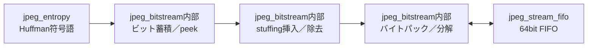

# jpeg_bitstream 設計仕様書

更新日：2026-10-05  
状態：初回RTL実装用（性能・画質は評価前）  
参照：[全体仕様](../design_spec.md)、[共通仕様](README.md)、[RTL実装共通仕様](rtl_contract.md)

図中の「内部」は本モジュール内の機能を表す。

## 役割・入出力

Huffman側の符号ビット列とDMA側のバイト列を変換する。CPU扱いのJPEGヘッダ・EOIは生成しない。

## encode

符号トークンは32bit bits、6bit nbits（1〜27）の初期案。上位の有効ビットから送るが、bits自体は右詰め。Huffman符号最大16bitとDC追加最大11bitを一度に受ける。蓄積器は初期案64bit、空き容量を確認してからトークンを受け付ける。

出力バイト内はMSBから符号を置く。生成byteがFFなら00を次に出し、両方送るまで状態を保持する。最終ブロック処理後に不足ビットを1で埋め、端数バイトがFFなら同じstuffingを行う。8bit未満の部分がなければ余分なパディングバイトは出さない。最後のパックへlastを付ける。

## decode

入力バイトのFF00から00を除去する。FFの直後で入力が止まったら状態を保持する。decodeは2026-10-06の拡張でDRI/RSTに対応し、許可されたRSTは区間境界で保持・検査する。FF00とRSTを区別し、それ以外の非ゼロを不正マーカーとして通知する（[拡張契約](../restart_decode.md)）。末尾FFだけも入力不正とする。

Huffman側へ最大16bitのpeekと有効ビット数を返し、consume成立時だけ取り除く。追加ビット読出しも同じ機構を使う。必要ビット未満なら入力を待ち、入力終了後も不足ならエラー。期待ブロック数完了後は端の1パディングを検査し、不要な余剰バイトを拒否する。

## 容量・性能・検証

蓄積器とstuffingの保留byteはモード間共有。通常1 byte／cycleを目標とする。FFの連続ではstuffingで時間・データ量が増えるため、出力停止と同時に検証する。

符号語のバイト跨ぎ、1〜7bit終端、FF00、FFだけで終了、入力が1 byteずつ到着する場合、64bit末尾keep、consume停止、同一データの二重出力がないことを確認する。
