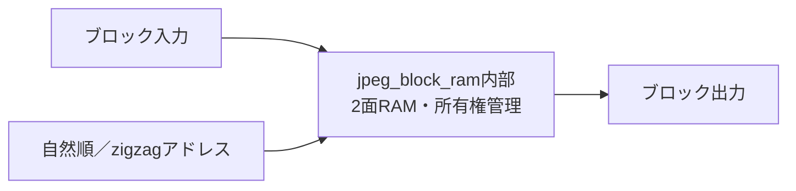

# jpeg_block_ram 設計仕様書

更新日：2026-10-05  
状態：初回RTL実装用（性能・画質は評価前）  
参照：[全体仕様](../design_spec.md)、[共通仕様](README.md)、[RTL実装共通仕様](rtl_contract.md)

図中の「内部」は本モジュール内の機能を表す。

## 役割・入出力

画素・係数を8×8単位で保持し、自然順とzigzag順を変換する。アクセスはbank、index、data、write_enable、およびブロック記述子で指定する。

## 容量・所有権

画素RAMは2面×64×8bit、係数RAMは各段間で2面×64×COEF_Wを設ける案。変換器の転置RAMは別資源。モード間は共有し、同時動作する段間は別RAMとする。

各面はFREE→FILL→FULL→READ→FREE。fill時に予約し、最後の書込み成立でFULL、最後の読出し消費でFREEにする。書込み途中の面を次段へ渡さない。同期RAMの初期読出し遅延は1 cycleとして応答を保持する。

## 配置・zigzag

自然順アドレスはrow×8+col。zigzag LUTはT.81の順序を用い、encodeではzigzag indexから自然順アドレスを生成して読み、decodeでは同じLUTを使って書く。量子化テーブルは自然順で参照する。

decodeでEOB後の係数は0とする。前ブロックの残留値を参照しないよう、全64位置を書き込むかゼロ有効管理を使う。初期案は全位置への書込み。

## 性能・検証

1アクセス／cycleを基本とし、読書き別面は並列可能な構成を選ぶ。自然順↔zigzag往復、面の再利用、停止中の所有権、ゼロ展開、2面間の競合を検証する。
