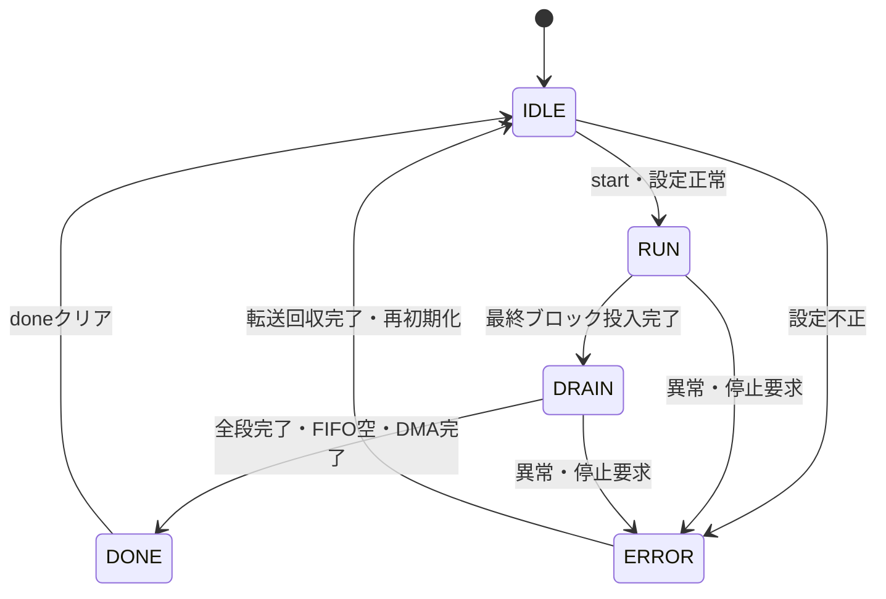

# jpeg_ctrl 設計仕様書

更新日：2026-10-05  
状態：初回RTL実装用（性能・画質は評価前）  
参照：[全体仕様](../design_spec.md)、[共通仕様](README.md)、[RTL実装共通仕様](rtl_contract.md)

## 役割・入出力

APB設定を検査してジョブを開始し、jpeg_dma_read・jpeg_dma_write・演算器・エントロピー段へモードと設定を配布する。各段のdone／errorとDMA未完了数を受け、busy／done／errorをAPBへ返す。

## 設定検査・動作

幅・高さは1〜65535、strideは成分幅以上、アドレス整列・加算範囲、対応サンプリング比、全必要テーブルvalidを検査する。CPUが非対応ヘッダを拒否し、RTLはロードされた設定の整合を検査する。

画像寸法から成分寸法・MCU数・総ブロック数を計算する。4:4:4はceil(W/8)×ceil(H/8)×3、4:2:2はceil(W/16)×ceil(H/8)×4、4:2:0はceil(W/16)×ceil(H/16)×6。MCUとblock_seqは32bit、バイト数は64bit。中間積は結果幅以上で計算する。

startで設定をスナップショットし、DC予測・FIFO・段カウンタを初期化する。最終ブロック投入後も出力を続け、全段とAXI応答の完了までbusyを保持する。

## 停止・エラー

最初のエラーコードを保持する。コード案は設定不正、テーブル不正、AXI読出し異常、AXI書込み異常、入力不足、符号不正、容量超過、演算範囲超過、ソフト停止。APBの単なる不正アクセスはジョブを停止せずPSLVERRだけを返す。

停止要求後は新規DMA発行を止め、提示済み要求と全応答を回収する。処理部出力は必要に応じ破棄するが、既発行Wデータは送信完了させる。dma_idle後に内部状態を初期化する。外部リセットは接続先を含むシステムリセットとする。

## 検証

設定境界、最大寸法の計数、エラー同時発生、最後のB応答待ち、停止中の遅延応答、再開始とモード切替を確認する。

リードとライトの未完了数・idle・done・errorを個別に受ける。一方のエラーでも双方に新規発行停止を指示し、read_idleかつwrite_idleまで復帰を待つ。全体doneはread_doneとwrite_doneおよび全演算段完了を集約して判定する。
