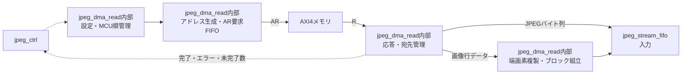

# jpeg_dma_read 設計仕様書

更新日：2026-10-05  
状態：初回RTL実装用（性能・画質は評価前）  
参照：[全体仕様](../design_spec.md)、[共通仕様](README.md)、[RTL実装共通仕様](rtl_contract.md)

## 役割・入出力

AXI4のAR／Rチャネルを担当する。encodeではplanar画像、decodeでは連続JPEG圧縮データを読む。jpeg_ctrlから開始・停止、画像寸法、成分ベース・stride、JPEGベース・入力バイト数を受け、入力側jpeg_stream_fifoへデータを渡す。

## 転送・アドレス生成

RDATAは64bit、同時未完了数は最大8。画像は通常1 beat（8 byte）で、8行のアドレスA、A+stride、…、A+7×strideへ別要求を発行する。MCU・成分・ブロック内行の順で生成し、1ブロック64 byteを組み立てる。

成分ベース・strideとJPEGベースは8 byte整列を初期案とする。右端の不足分は自然整列4／2／1 byteアクセスに分割し、返却レーンを抽出する。有効領域外は読み出さず、最後の有効列・行を複製する。端の外側だけのブロックにも最後の有効画素を使う。

JPEGは最大16 beatsのINCR。128 byte、4 KiB境界、残り有効データの範囲で区切る。末尾は必要なら4／2／1 byte要求に分割する。

ARIDは初期案として同一ID。接続先が同一IDの8要求を受け付けることを確認する。要求FIFOに宛先面・行・バイト位置・転送量を保持し、応答順に対応付ける。各要求は最終R beatの転送成立で解放する。

## バッファ・発行条件

ラインバッファは持たない。画素ブロックRAMは2面×64 byte、要求FIFOは8エントリ。入力側のJPEG FIFOは2,048 byteの初期案で、最大8要求×128 byteを受信できる空きをAR発行前に予約する。画素は宛先面の領域を予約する。

未完了数と予約可能容量の両方が許す場合に発行する。消費中の面と次ブロックを読む面を分け、要求をブロック境界でも継続する。RAM面の所有権はjpeg_block_ramの規則に従う。

## 完了・エラー・検証

read_doneは全要求のR転送が完了し、全有効データが入力側へ渡った時。全体ジョブのdoneとは別である。RRESP異常、入力範囲・アドレスあふれを通知する。

停止時は新規発行を止め、提示済みARVALIDは成立まで保持する。発行済み応答を受け取れる容量を確保し、全要求を回収してread_idleを通知する。

平均500 ns、必要43.50 MB/sを基準に、8要求同時受付、AR/R停止、境界・端数、処理部停止、ライトとの競合を検証する。
