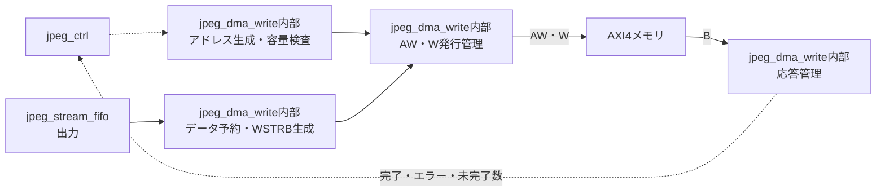

# jpeg_dma_write 設計仕様書

更新日：2026-10-05  
状態：初回RTL実装用（性能・画質は評価前）  
参照：[全体仕様](../design_spec.md)、[共通仕様](README.md)、[RTL実装共通仕様](rtl_contract.md)

## 役割・入出力

AXI4のAW／W／Bチャネルを担当する。encodeでは連続JPEG圧縮データ、decodeではplanar画像を書き込む。出力側jpeg_stream_fifoからデータを受け、jpeg_ctrlから画像配置、JPEG出力先・容量上限、開始・停止を受ける。

## 転送・アドレス生成

WDATAは64bit、最大8要求。JPEGは最大16 beats（128 byte）のINCRで、4 KiB境界と末尾で短縮する。最終beatの有効バイトはWSTRBで指定し、容量上限を超える有効バイトを書き込まない。

復号画像は成分別ラスタの各行へ1 beat（8 byte）で書く。アドレスはbase + (block_y+row)×stride + block_x。有効領域だけWSTRBを立て、有効画素のない行は発行しない。strideの余白を保存する。

AWIDは初期案として同一ID、応答FIFOでBRESPを要求に対応付ける。Wは要求順に送り、異なるバーストを混在させない。AWとWの成立を独立して管理し、Wデータの完了とB応答の完了を区別する。

## バッファ・発行条件

出力FIFOは初期案2,048 byte、要求FIFOは8エントリ。画像の行取出しは2面64 byteブロックRAMを使用し、ラインバッファは持たない。

1バースト分の全データと宛先範囲を確保してからAWを提示する。W転送成立後はデータを解放し、B応答まではアドレス・量・エラー対応情報を保持する。B待ち中も次要求を発行できる。

## 完了・停止・検証

write_doneは入力終端まで送信し、全W転送・全B応答が正常完了した時。OUTPUT_BYTESはWで転送した有効byte数を数え、エラー時も値を保持する。書込み完了の保証はwrite_doneで判断する。

BRESP異常、容量超過、アドレスあふれを通知する。停止時も提示済みAW/WのVALIDを撤回せず、確保済みデータを送信し全B応答を回収してwrite_idleを通知する。新しい要求は停止する。

圧縮率1:1で43.50 MB/s、応答平均500 nsを基準とする。AW/W/Bの独立停止、8要求のB待ち、末尾WSTRB、4 KiB境界、端画素除外、readとの競合と停止後の回収を検証する。
