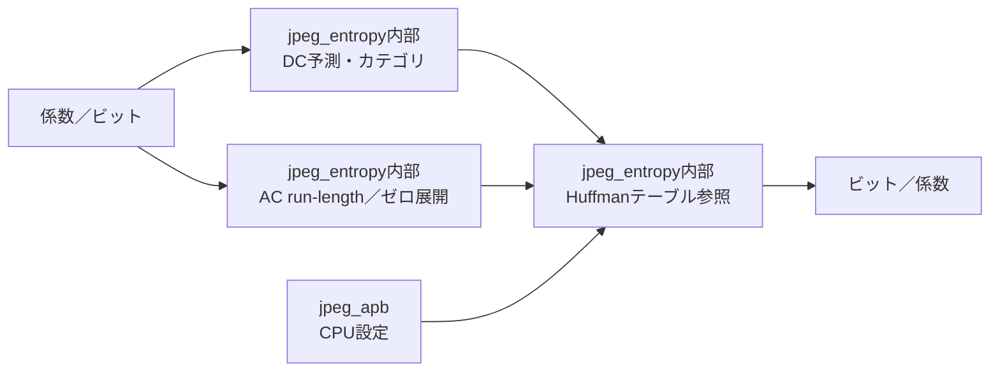

# jpeg_entropy 設計仕様書

更新日：2026-10-05  
状態：初回RTL実装用（性能・画質は評価前）  
参照：[全体仕様](../design_spec.md)、[共通仕様](README.md)、[RTL実装共通仕様](rtl_contract.md)

図中の「内部」は本モジュール内の機能を表す。

## 役割・入出力

encodeではzigzag順係数を符号語に、decodeでは符号語からzigzag順係数に変換する。成分別DC予測値を保持する。ビット処理部とは符号・長さの組またはpeek/consume要求をvalid/readyでやり取りする。

## CPU設定テーブルの初期案

DC2面、AC2面を用意し、成分ごとに選択する。DCはカテゴリ0〜11、ACはサイズ1〜10とEOB/ZRLを対象に検査する。テーブル数・IDは初期のBaseline対応制限として全体仕様へ反映する。

encodeテーブルは各面256エントリ、1エントリ32bit。bits[15:0]は右詰め符号、[20:16]は長さ1〜16、[21]はvalid、他は0。symbolで参照し、長さ0は未設定とする。

decodeテーブルはCPUがcanonical Huffmanから生成する。各長さ1〜16のmin_code、max_code、先頭symbol位置、countと、最大256 byteのsymbol列をAPBでロードする案。APB要素配置とcommit検査はRTL実装共通仕様に従う。CPUでコードの重複・過剰割当・全1符号の禁止を検査し、RTLでは容量・カテゴリ・参照境界を検査する。

## encode／decode動作

encode：DC差分のカテゴリと追加ビットを出力。ACは0の連続を数え、非ゼロ値に対してrun/sizeを生成する。16個の0はZRL、残り全部0ならEOB。負値の追加ビットはJPEGの規則に合わせる。

decode：コードの長さに対応したテーブルを検索し、追加ビットから符号付き値を復元する。DCは成分別予測へ加算、ACは指定runの0を生成する。EOB後も63番まで0を書き込み、ZRLによる位置超過・不正カテゴリをエラーにする。

DC予測更新は符号化・復号がそのDCを確定した時だけ行う。停止による二重更新を防ぐ。開始で全成分の予測を0にする。

## 構成・性能・検証

初期案は16長の比較を並列化した復号器と小規模symbol RAM。符号長探索を最大16 cycleの逐次処理にはせず、符号語・追加ビット・テーブル読出しをパイプライン化する。開始間隔256 cycle／ブロック以下を高密度係数でも評価する。

テーブルロードの往復、標準・カスタムテーブル、正負カテゴリ境界、EOB/ZRL、全非ゼロ、無効コード、入力不足、ランダム停止を検証する。RTL外部のJPEG実装との相互運用を必須とする。
