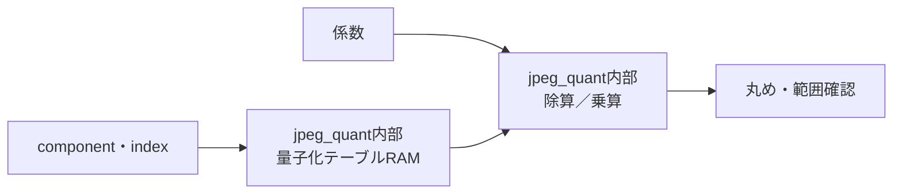

# jpeg_quant 設計仕様書

更新日：2026-10-05  
状態：初回RTL実装用（性能・画質は評価前）  
参照：[全体仕様](../design_spec.md)、[共通仕様](README.md)、[RTL実装共通仕様](rtl_contract.md)

図中の「内部」は本モジュール内の機能を表す。

## 役割・入出力

自然順の係数列とcomponent/indexを受け、encodeは量子化、decodeは逆量子化して同じ順で出力する。componentからCPU設定のテーブルIDを選ぶ。

## テーブル・演算

初期案は3面×64×8bitの量子化RAM。CPUがDQTのzigzag順を自然順に変換してAPBでロードする。値0は拒否する。選択IDと有効状態を開始時に確認する。

encodeは最近傍の整数係数へ量子化する。Qを1〜255として、符号を分離し`abs_out = floor((2*abs(in)+Q)/(2*Q))`、最後に符号を戻す。半分は絶対値を大きくする。内部の加算・符号反転は拡張幅で行う。

decodeは量子化係数×Q。出力は拡張幅で保持し、IDCT入力幅を越える場合は演算範囲エラーとする。encodeの係数とDC差分はHuffmanカテゴリの対応範囲も確認する。

## 構成・性能

encodeは32段のパイプライン復元除算器を使用し、商と余りから最近傍へ丸める。受付間隔1cycle、テーブル参照・丸めを含む最短遅延34cycle。逆量子化は32×8bit乗算を40bitで計算し、32bit出力の範囲を検査する。停止時の全段保持と幅は[RTL実装共通仕様](rtl_contract.md)に従う。

## 検証

Q=1、255、全1〜255、正負の丸め境界、0、最大係数で整数参照と比較する。テーブルID切替と停止中のindex保持も確認する。除算器の構成と幅は実装共通仕様に定義した。
