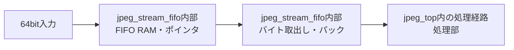

# jpeg_stream_fifo 設計仕様書

更新日：2026-10-05  
状態：初回RTL実装用（性能・画質は評価前）  
参照：[全体仕様](../design_spec.md)、[共通仕様](README.md)、[RTL実装共通仕様](rtl_contract.md)

図中の「内部」は本モジュール内の機能を表す。

## 役割・入出力

64bit data／8bit keep／lastのストリームを保持する。画像の64bit行データと1サンプル列、圧縮データと1 byte列の幅変換を接続する。

## 容量・動作

JPEG入力・出力FIFOはそれぞれ初期案2,048 byte（256エントリ×64bit）。keep／lastは各エントリとともに保持する。画像側はDMAの2面64 byte RAMを使い、フルライン分は確保しない。

emptyでvalid=0、満杯ならready=0。同時enqueue/dequeueを許可する。幅変換中にエントリを解放するのは最後の有効バイトが消費された時。最終エントリだけ短いkeepを許し、空の転送は許可しない。

出力パックは8 byteで転送し、終端に不足したバイトはkeepで示す。lastをデータと同時に保持する。ブロック境界は記述子で扱い、lastと混同しない。

## 予約容量

DMAはFIFOの実使用量に発行済みリードの予約量を加えて空きを判断する。返却した量は予約から使用へ移し、二重に数えない。RREADYを常時出せる容量を予約するが、RAM競合時は正しく停止できる。

書込みFIFOのデータはW転送成立まで保持する。送信済みデータをB応答のために保持しない。要求管理はDMA側で別に行う。

## 検証

満杯・空、同時入出力、1〜7 byte末尾、処理部停止、最後のバイト停止、予約上限、wrap-aroundを確認する。RAM読出しレイテンシに合わせたvalid生成は実装時に確定する。
