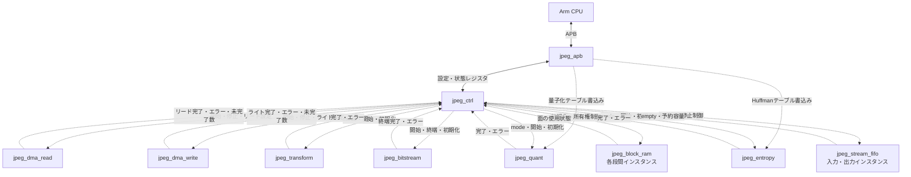

# jpeg_top 設計仕様書

更新日：2026-10-05  
状態：初回RTL実装用（性能・画質は評価前）  
参照：[全体仕様](../design_spec.md)、[共通仕様](README.md)、[RTL実装共通仕様](rtl_contract.md)

## 役割・入出力

APBスレーブとAXI4マスターを外部へ公開し、エンコード／デコードを切り替える。CPUで扱うJPEGヘッダ・RGB変換は含めない。AXIアドレス幅ADDR_W・ID幅ID_Wは接続先決定後に確定する。

## ブロック間接続

実線はデータの進行方向、破線は設定・制御・状態の接続を示す。データ接続には逆方向のreadyによる停止制御が伴う。同名のブロックはモード間で共有し、入力／出力FIFOと段間RAMは用途別インスタンスとする。

### エンコードのデータ接続

```mermaid
flowchart LR
    MEM["DRAM"]
    subgraph TOP["jpeg_top：エンコード経路"]
        RD["jpeg_dma_read<br/>画像読出し"]
        WR["jpeg_dma_write<br/>JPEG書込み"]
        IN["jpeg_stream_fifo<br/>入力・幅変換"]
        PIX["jpeg_block_ram<br/>画素ブロック"]
        T["jpeg_transform<br/>DCT"]
        R1["jpeg_block_ram<br/>自然順係数"]
        Q["jpeg_quant<br/>量子化"]
        R2["jpeg_block_ram<br/>zigzag読出し"]
        E["jpeg_entropy<br/>DC・AC・Huffman"]
        B["jpeg_bitstream<br/>ビット蓄積・stuffing"]
        OUT["jpeg_stream_fifo<br/>出力・64bitパック"]
        RD -->|画素・64bit| IN
        IN -->|画素・記述子| PIX --> T
        T -->|自然順係数| R1 --> Q --> R2
        R2 -->|zigzag順係数| E
        E -->|符号語・長さ| B
        B -->|バイト列| OUT
        OUT -->|64bit・keep・last| WR
    end
    MEM -->|AXI4 R| RD
    WR -->|AXI4 W・B応答管理| MEM
```

### デコードのデータ接続

```mermaid
flowchart LR
    MEM["DRAM"]
    subgraph TOP["jpeg_top：デコード経路"]
        RD["jpeg_dma_read<br/>JPEG読出し"]
        WR["jpeg_dma_write<br/>画像書込み"]
        IN["jpeg_stream_fifo<br/>入力・バイト分解"]
        B["jpeg_bitstream<br/>stuffing除去・peek"]
        E["jpeg_entropy<br/>Huffman・DC復元・AC展開"]
        R2["jpeg_block_ram<br/>逆zigzag配置"]
        Q["jpeg_quant<br/>逆量子化"]
        R1["jpeg_block_ram<br/>自然順係数"]
        T["jpeg_transform<br/>IDCT"]
        PIX["jpeg_block_ram<br/>画素ブロック"]
        OUT["jpeg_stream_fifo<br/>出力・幅変換"]
        RD -->|64bit・keep・last| IN
        IN -->|バイト列| B
        B -->|peekビット・有効数| E
        E -.->|consume| B
        E -->|zigzag順係数| R2
        R2 -->|自然順係数| Q --> R1 --> T
        T -->|画素・記述子| PIX --> OUT
        OUT -->|画素行・64bit| WR
    end
    MEM -->|AXI4 R| RD
    WR -->|AXI4 W・B応答管理| MEM
```

### 設定・制御・状態の接続

jpeg_dma_readのブロック組立、変換器の転置RAM、各演算モジュールのテーブルRAMはそのモジュール内の機能。アドレスチャネル・応答などのAXI4詳細はDMA仕様に従う。図は論理接続を示し、各RAMのポート接続と調停はRTL実装時に具体化する。

## 動作・共有資源

encode：jpeg_dma_read→画素ブロック→DCT→量子化→zigzag→entropy→bitstream→jpeg_dma_write。
decode：jpeg_dma_read→bitstream→entropy→逆zigzag→逆量子化→IDCT→画素ブロック→jpeg_dma_write。

FIFO、画素ブロックRAM、係数RAM、変換器、量子化系をモード間で共有する。段間のバッファは別インスタンスとし、一つの2面RAMを全段で奪い合う構成にはしない。CPU設定のスナップショットを各段へ配布し、ジョブ中は切替えない。

## 完了・検証

各段完了、全FIFO空、AXI未完了数0、全書込み応答正常を全体制御が確認する。モード切替は停止状態だけで行う。

Verilatorで全体接続、連続ジョブ、ランダム停止、エラーと停止後の再開始を確認する。性能は各段のbusy・stallとページサイクル数を測定する。
