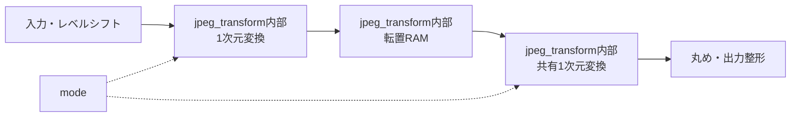

# jpeg_transform 設計仕様書

更新日：2026-10-05  
状態：初回RTL実装用（性能・画質は評価前）  
参照：[全体仕様](../design_spec.md)、[共通仕様](README.md)、[RTL実装共通仕様](rtl_contract.md)

図中の「内部」は本モジュール内の機能を表す。

## 役割・入出力

encodeでDCT、decodeでIDCTを行う共有演算器。入力・出力は自然順64要素のブロック。encode入力は8bit画素、内部で128減算。decode入力は逆量子化係数、出力は128加算と0〜255飽和後の8bit画素。

## 演算方式の初期案

分離型2次元変換。8乗算器の内積演算器を1組用い、8項の加算をパイプライン化して1結果／cycleを目標とする。DCTはC×X×C転置、IDCTはC転置×X×C。2パスで同じ演算器を時間共有する。

C[k,n]はk=0で1/sqrt(8)、それ以外で0.5×cos((2n+1)kπ/16)。係数定数は小数14bit。定数を固定して参照モデルとRTLで共用する。

1パスごとの丸めは最近傍、半分は絶対値を大きくする。COEF_W=32、パス間48bit、積64bit、加算72bitを使用する。整数定数表、RAMの8要素同時参照構成、パイプラインの段数は[RTL実装共通仕様](rtl_contract.md)に定義する。

## バッファ・性能

64要素の入力、転置、出力保持領域を用いる。出力停止時は出力領域を確保してから次パスを進める。計算は2パス各64結果にパイプラインと転送時間を加え、開始間隔256 cycle／ブロック以下を目標とする。8乗算器案の面積・256 MHz成立は対象デバイス決定後に評価する。

## 検証・確定事項

定数、単一画素、勾配、最大高周波、逆量子化の最大範囲で参照モデルと比較する。スケール・丸めはモデルと一致させ、外部復号結果との差も測定する。係数幅と丸めは実装共通仕様に固定し、画質誤差のしきい値は実装後の参照結果から評価する。
