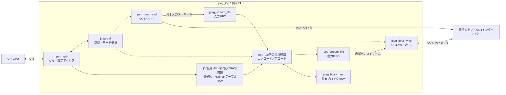
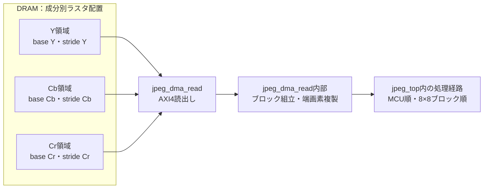
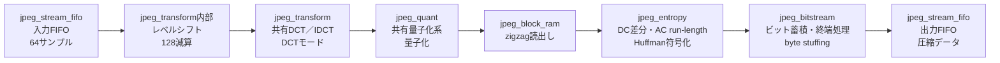
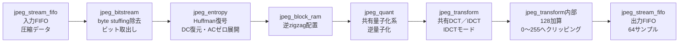
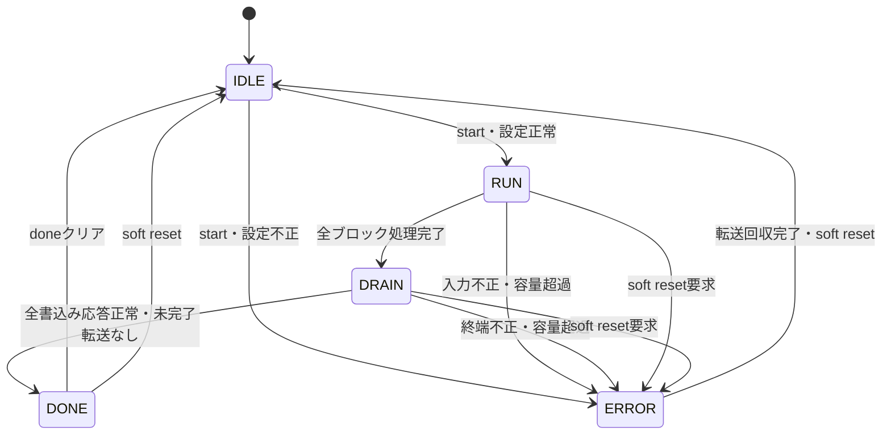

# JPEG_TOP 設計仕様書

更新日：2026-10-05  
参照：[要件定義](requirements.md)  
状態：初版・設計案

要件で確定しているAPB制御、内蔵DMAのAXI4入出力、256 MHz、100 ppm、エンコード／デコードの排他動作を前提とする。未決の要件に対する選択は本書の設計案とし、性能評価後に確定する。

## 1. 全体構成

CPU（Arm）がJPEGヘッダと設定を扱い、RTLがブロック演算と圧縮データの符号化・復号を担当する案とする。DMAコントローラーはjpeg_dma_readとjpeg_dma_writeの独立ブロックとしてRTLに内蔵し、外部メモリへAXI4マスターとして接続する。DMAとJPEG処理部は内部ストリームで接続する。

実線はデータ・レジスタアクセス、破線は制御を示す。内部の処理順序は下記のモード別フローに示す。

| 処理 | 担当する設計案 |
|---|---|
| JPEGヘッダ生成・解析、対応形式の判定 | CPU |
| 量子化・Huffmanテーブルの準備とAPB経由の設定 | CPU |
| RGB↔YCbCr変換、サンプリング変換 | CPU側。性能不足ならRTL化を検討 |
| DMA設定 | CPU（APB経由） |
| メモリ読出し・書込み | RTL内蔵DMA |
| 成分別ラスタ配置とMCU順の変換・端画素処理 | 内蔵DMA・ブロック組立回路 |
| DCT／IDCT、量子化／逆量子化 | RTL |
| zigzag、DC差分、run-length、Huffman処理 | RTL |
| 圧縮データのビット・バイト処理 | RTL |

CPU処理とDMAによる並べ替えも100 ppmの評価対象に含める。内蔵DMAのアドレス生成と並べ替え回路の分担は、画素配置と目標性能に基づいて決定する。

## 2. 対応範囲とデータ形式

- Baseline Sequential DCT、Huffman符号化、YCbCr各8bit。
- サンプリング比の設計案は4:4:4、4:2:2、4:2:0。初期検証は4:4:4から行う。
- 初期案は3成分の単一インターリーブscan。複数scanは未決。
- 量子化テーブルは8bit値をCPUから設定し、0は不正設定として扱う案とする。
- エンコーダー・デコーダーのHuffmanテーブルはCPUからAPB経由で設定する。RTL内の固定テーブルには依存しない。
- エンコード時はCPUが符号と符号長を準備し、出力JPEGのDHTと一致するテーブルを設定する。テーブル最適化をCPU側で行うかは未決。
- デコード時はCPUが入力JPEGのDHTから復号用テーブルを生成し、APB経由で設定する。
- DC／AC種別、テーブルID、成分ごとの参照先を設定可能とする。初期のDC／ACテーブル数・APB書込み形式は[エントロピー仕様](blocks/jpeg_entropy.md)に設計案として定義する。
- Restart対応は未決。初期案ではCPUがDRIを確認し、非ゼロなら開始を拒否する。
- Progressive、LosslessはCPUが拒否する。

### 2.1 DRAM上の画像形式（設計案）

エンコード入力は8bit unsignedのYCbCr planar形式とする。Y、Cb、Crを独立した領域に置き、各領域内は左上から行方向へ並ぶラスタ順とする。DRAM上の配置と、処理部内部のMCU順は区別する。

| 項目 | 定義 |
|---|---|
| 1サンプル | 1 byte、0〜255。DCT前の128減算はRTLで行う |
| 成分領域 | Y、Cb、Crそれぞれにベースアドレスを設定 |
| 行の配置 | 成分ごとにstride（byte）を設定。strideはその成分の有効幅以上 |
| サンプルアドレス | `base_c + y * stride_c + x`（cはY／Cb／Cr） |
| 行末の余白 | 有効画素ではなく、符号化しない |
| 色変換 | CPU側でYCbCrへ変換。係数・値域の変換規則は別途確定 |
| 成分の間引き | CPU側でサンプリング比に応じたCb／Cr画像を用意 |

幅W・高さHに対する成分寸法とMCU構成は次の設計案とする。ceilは切り上げを表す。

| サンプリング比 | Y寸法 | Cb・Crそれぞれの寸法 | MCUの画像範囲 | MCU内のブロック順 |
|---|---|---|---|---|
| 4:4:4 | W × H | W × H | 8 × 8 | Y、Cb、Cr |
| 4:2:2 | W × H | ceil(W/2) × H | 16 × 8 | Y左、Y右、Cb、Cr |
| 4:2:0 | W × H | ceil(W/2) × ceil(H/2) | 16 × 16 | Y左上、Y右上、Y左下、Y右下、Cb、Cr |

MCUは画像の左上から行方向へ処理する。DMAが各成分領域から8×8ブロックを読み出し、ブロック内ラスタ順のサンプルを内部ストリームへ送る。固定成分順Y→Cb→Crを初期案とし、CPUはJPEGのscan順をこれに合わせる。異なるscan順の対応は詳細設計で決める。

端数部分はDMA／ブロック組立回路が成分ごとの最終列・最終行の画素を複製する。DRAMにMCU寸法までのパディングを用意する必要はなく、有効領域外を読み出さない。

初期構成ではラインバッファを搭載せず、ブロック単位でアクセスする。AXI4の初期転送仕様は第5節に定義する。

デコード出力も同じplanar配置とし、DMAがブロック順の復号結果を各成分領域へ書き戻す。端の余剰画素とstrideの余白は書き込まない。RGB変換・色差のアップサンプリングはCPU側で行う案とする。

### 2.2 DRAM上のJPEGデータ

JPEG圧縮データは連続したバイト列とする。デコード時はCPUがヘッダを解析し、SOS後の圧縮データの先頭アドレスとEOI前までのバイト数をDMAへ設定する。エンコード時は圧縮データの書込み先アドレスと容量上限を設定する。

CPUはエンコード時にヘッダ、RTL出力、EOIを結合する。デコード時はSOS後からEOI前までの圧縮データをRTLへ渡す。RTL出力にはbyte stuffingを含める。

画像の最大幅・最大高さはそれぞれ65535画素とする。幅・高さは各16bitで保持する。画素数・ブロック数の積は32bit以上で計算し、切り捨てを防ぐ。成分数、端数パディング、転送バイト数、アドレス加算を含む計算は、それぞれの最大値に応じた幅を詳細設計で確保する。

## 3. RTLブロック

[ブロック間接続図](blocks/README.md#ブロック間接続)にエンコード・デコードのデータ経路と設定・制御・状態の接続を示す。図中の「内部」は所属モジュール内の機能、「処理経路」は複数モジュールの接続を表す。

| ブロック | 役割 |
|---|---|
| `jpeg_top` | APB、AXI4、各ブロックの接続 |
| `jpeg_dma_read` | AXI4 AR／R、読出しアドレス生成、入力ブロック組立 |
| `jpeg_dma_write` | AXI4 AW／W／B、書込みアドレス生成、応答管理 |
| `jpeg_ctrl` | 設定保持、モード選択、ブロック数管理、完了・エラー |
| `jpeg_apb` | APBアクセス、レジスタ・テーブル読み書き |
| `jpeg_stream_fifo` | 入出力停止の吸収、有効バイト管理 |
| `jpeg_block_ram` | 64サンプル／係数の保持、zigzag用アドレス変換 |
| `jpeg_transform` | モード切替式DCT／IDCT、転置バッファ |
| `jpeg_quant` | 量子化／逆量子化、テーブル参照 |
| `jpeg_entropy` | DC予測、run-length、Huffman符号化／復号 |
| `jpeg_bitstream` | ビット蓄積、byte stuffing、終端処理 |

DCT／IDCT、量子化系、ブロックRAM、テーブルRAM、FIFOを共有する。方向固有の制御は分け、演算器の共有方法はサイクル数と回路規模を評価して決める。

## 4. 処理フロー

### エンコード

1. CPUがAPB経由で量子化・Huffmanテーブル、画像寸法、サンプリング比を設定する。
2. 64サンプルを受け取り、128を減算してDCTへ渡す。
3. DCT、量子化、zigzag順の読出しを行う。
4. 成分別DC差分とACのrun-lengthをHuffman符号化する。
5. ビットをバイト化して出力する。全ブロック完了後に終端を処理する。

### デコード

両フローは排他的に動作する。同名の共有ブロックは同じ資源を使い、独立した2系統の回路を意味しない。

1. CPUがヘッダを解析し、量子化・Huffmanテーブルと画像情報を設定する。
2. 圧縮データを入力し、Huffman復号、DC復元、ACのゼロ展開を行う。
3. 係数を元の配置へ戻し、逆量子化、IDCTを行う。
4. 128を加算し、0〜255へクリッピングして64サンプルを出力する。

DC予測値は成分ごとに保持し、開始・リセットで0にする。圧縮データ内の`FF`には`00`を挿入し、復号時に除去する。符号化の最後の不足ビットは1で埋める。これらの処理は[T.81 Annex F](https://www.w3.org/Graphics/JPEG/itu-t81.pdf)を参照する。

## 5. インターフェース・制御

### DMAの外部I/F：AXI4

内蔵DMAはAXI4マスターとして、入力データをメモリから読み出し、処理結果をメモリへ書き込む。CPUがAPB経由で転送元・転送先アドレス、転送量、出力容量を設定する。画素配置に応じた各成分のベースアドレスとstrideを設定する。レジスタ幅・配置は詳細設計で定義する。

| 項目 | 方針 |
|---|---|
| データバス幅 | リード・ライトとも64bit |
| アドレス幅・ID幅 | 接続先の条件に基づき後で決定 |
| リードバースト長 | 画像：1 beat、連続JPEGデータ：最大16 beats |
| ライトバースト長 | 復号画像：1 beat、圧縮データ：最大16 beats |
| アウトスタンディング数 | リード・ライトそれぞれ最大8要求 |
| バッファ容量 | 転送パラメータとメモリ応答遅延に基づき決定 |

DMAはAXI4のアドレス・データ・応答を管理し、出力容量を超える書込みを発行しない。末尾の有効バイトに応じた書込みと、アクセスエラーの検出を行う。具体的なバースト分割・アラインメント・応答管理は詳細設計で定義する。

### AXIリードの性能見積り・初期仕様

入力条件はAR転送成立からリードデータ返却まで平均500 ns、書込みアドレス・データ発行から応答まで平均500 nsとする。256 MHzでは500 ns＝128 cycle。リード見積りでは1 beat要求の応答待ち時間として使用する。長いバーストの先頭／末尾の応答時間、ARREADY待ち、遅延分布、読出し・書込み競合は追加評価する。

4:4:4を画像入力の帯域基準とすると、A4・300 dpi・100 ppmで約43.50 MB/sが必要となる（14.50 M画素/s × 3 byte）。ブロックの1行は8 byteなので64bitの1 beat読出しとする。必要要求数は約5.44 M要求/s、平均待ち時間だけから求めた同時要求数は`ceil(43.50 MB/s × 500 ns / 8 byte) = 3`。

余裕を持たせて最大8要求を採用する。理想的な待ち時間律速の上限は`8 × 8 byte / 500 ns = 128 MB/s`、必要帯域の約2.94倍。これは8要求を継続発行でき、メモリがその要求レートを受け付ける場合の概算であり、平均遅延だけによる性能保証ではない。

- 画像読出し：64bit、1 beat（ARLEN=0）、通常は8 byte転送（ARSIZE=3）。8行分の要求を重ねて1ブロックを組み立て、ブロック間でも発行を継続する。
- ラインバッファは搭載しない初期構成とする。既存の2面ブロックRAMに加え、発行済み要求の管理と返却データの受入れ容量を確保する。次のブロックへ移るたびに全要求の完了を待つ制御は避ける。
- JPEG連続データ：最大16 beats（128 byte）のINCRバースト。末尾・4 KiB境界などで短縮し、設定された有効範囲外を読まない。
- 同時要求は最大8。受入れ容量を要求発行時に予約し、処理部が停止しても発行済みデータを保持できるようにする。ID方針と返却順の管理は詳細設計で決定する。
- 画像ベースアドレスとstrideは8 byte境界に整列させる初期仕様とする。右端の不足部分は短いサイズのアクセスに分割し、有効範囲外を読み出さず端画素を複製する。
- リード・ライトは共通64bitポートの独立チャネルを使用する。

AXIのARLEN・ARSIZE・IDと順序規則は[Arm AXI仕様](https://developer.arm.com/-/media/Arm%20Developer%20Community/PDF/IHI0022H_amba_axi_protocol_spec.pdf)に従う。検証では平均500 nsに加え遅延変動と読書き競合を与え、ページ全体で100 ppmを確認する。デコードの圧縮入力帯域は画像内容・テーブルに依存するため、模擬画像セットで別途評価する。

### 画像リードのアドレス発行

8×8ブロック左上のアドレスをA、成分のstrideをSとすると、8行分の読出しアドレスは`A, A+S, …, A+7S`となる。各要求は64bit幅の1 beat、8 byteであり、8要求で64 byteのブロックを取得する。8行を連続アドレスの8 beatsとして発行するものではない。最大8要求を未完了のまま重ねて発行し、返却データを行位置に対応付けて保持する。

### AXIライトの性能見積り・初期仕様

性能見積りでは圧縮率1:1、すなわち圧縮データ量を有効YCbCrサンプル数と同じとする。4:4:4では26,099,520 byte／ページ、必要書込み帯域は約43.50 MB/s。エンコード時は画像読出しと圧縮データ書込み、デコード時は圧縮データ読出しと画像書込みがあるため、DRAMの合計有効帯域は約87.00 MB/sを基準とする。バス上の余白・境界処理・CPUアクセスは別途加算する。

| 項目 | 初期仕様 |
|---|---|
| WDATA幅 | 64bit（8 byte／beat） |
| エンコード出力 | INCR、最大16 beats（128 byte／要求、通常AWLEN=15） |
| デコード出力 | 成分ごとに1行8 byte、1 beat／要求（AWLEN=0） |
| アウトスタンディング | 最大8要求。AW転送成立からB応答受信までをカウント |
| 終端・画像端 | バースト短縮とWSTRBで有効バイトだけを書込み |

圧縮データは出力FIFOに128 byteを集めて書き込む。1要求のW転送は最短16 cycle＝62.5 ns。AW/Wの発行期間に加えてB応答まで500 nsと仮定すると、要求保持時間は約562.5 ns。平均帯域から必要な同時要求数は`ceil(43.50 MB/s × 562.5 ns / 128 byte) = 1`となる。256 MHzでのデータチャネル自体の理論帯域は2,048 MB/sであり、実効帯域はメモリ受付能力と待ち時間に依存する。

復号画像はstrideで行が分離するため、ライトも8 byteの要求を8行へ発行する。1 beat転送時間を含む約503.9 nsで見積もると必要数は3要求。両モード共通で余裕を持って最大8要求とする。

DMAはAW/Wそれぞれの進行を管理し、要求の書込みデータを確保してから発行する。B応答を待つ間にも次の要求を発行し、全B応答の正常完了後にdoneを通知する。送信データはW転送成立後に解放し、B応答までは要求情報を保持する。FIFO容量の初期案はブロック別仕様に定義する。

圧縮率1:1は性能評価条件であり、JPEG出力容量の絶対上限とはしない。設定テーブル・画像によって入力より大きくなる場合も扱い、容量超過時は指定したエラー処理を行う。検証では読書き同時動作、応答遅延変動、端数転送を含めて100 ppmを確認する。

### DMAと処理部の内部I/F（設計案）

内部ストリームは`data`、バイト単位の`keep`、`valid`、`ready`、`last`を持つ。DMA・FIFO間は64bitとし、処理部のサンプル／係数幅に合わせて幅変換を設ける。

- 転送は`valid && ready`のクロックで成立する。
- 先に処理するバイトを下位へ配置し、`keep`で有効バイトを示す。
- `last`は最後の内部転送を示す。
- 出力停止中はデータと制御信号を保持し、内部容量が不足したら入力を停止する。
- エンコードでは期待サンプル数、デコードでは期待ブロック数と入力終端を確認する。

### APBレジスタ（32bit、アドレスは設計案）

| オフセット | 名称 | 内容 |
|---|---|---|
| `0x00` | CONTROL | start、mode（0：encode、1：decode）、soft reset |
| `0x04` | STATUS | busy、done、error。done/errorは書込み1でクリア |
| `0x08` | IMAGE_SIZE | 幅16bit、高さ16bit |
| `0x0C` | FORMAT | サンプリング比・成分設定 |
| `0x10` | INPUT_BYTES | 有効入力バイト数 |
| `0x14` | OUTPUT_LIMIT | 出力容量上限（byte） |
| `0x18` | OUTPUT_BYTES | 出力転送済みバイト数 |
| `0x1C` | ERROR_CODE | 設定不正、入力不正、容量超過など |
| `0x20` | TABLE_ADDR | 量子化／Huffman、DC／AC、テーブルID、アクセス位置 |
| `0x24` | TABLE_DATA | 選択したテーブルのデータ。アクセス後に位置を更新 |
| TBD | DMA_SRC_ADDR | 転送元アドレス。幅・配置はAXI4アドレス幅に合わせて決定 |
| TBD | DMA_DST_ADDR | 転送先アドレス。幅・配置はAXI4アドレス幅に合わせて決定 |
| TBD | Y_BASE／CB_BASE／CR_BASE | 画像側の各成分ベースアドレス。encodeでは入力、decodeでは出力 |
| TBD | Y_STRIDE／CB_STRIDE／CR_STRIDE | 各成分の行間隔（byte） |

テーブルは処理開始前にCPUがロードする。busy中のテーブル変更はAPBエラーとし、未設定の必要テーブルを参照する開始要求は設定不正として拒否する。成分ごとのテーブル選択レジスタの配置は詳細設計で定義する。

APBは待ち状態とアクセスエラーを返せる構成とする。初期のビット配置とテーブル形式は[APB仕様](blocks/jpeg_apb.md)に定義し、追加レジスタ配置は接続先のアドレス幅決定後に確定する。

状態遷移は`IDLE → RUN → DRAIN → DONE`、異常時は`ERROR`とする。開始時に設定を確定し、busy中の設定変更・再開始はAPBエラーにする。doneは全出力のAXI4書込み応答を正常に受信し、未完了のDMA転送と内部データがない時点で通知する。
エラー時は新規DMA要求と入力受付を停止してerrorを保持する。発行済みAXI4転送は応答を回収し、DMAが停止可能になってからCPUがsoft resetして再設定する。出力済みデータはCPUが破棄する。soft resetで発行済み転送を放棄しない。

クロックは単一256 MHz。リセットは低有効・同期式を設計案とし、FIFO、状態、DC予測値を初期化する。テーブルは開始前に再ロードする。外部リセットはAXI4接続先との整合を取るシステムリセットとして扱う。

## 6. 演算・バッファ方針

DCT／IDCTは分離型2次元変換とし、1次元演算器と転置RAMを用いる案とする。固定小数点の係数・中間幅、量子化の実装、丸めは参照モデルと範囲解析で決める。桁あふれによる折返しを許容しない。

ブロックRAMは2面とし、転送と演算を重ねる。共有演算器・RAMの競合はready制御で調停する。FIFO深さ、演算器数、テーブルRAM容量は性能見積り後に確定し、現時点で1サンプル／cycleは保証しない。

## 7. 性能設計と検証

100 ppmは平均0.6秒／ページ、256 MHzでは153,600,000 cycle／ページに相当する。CPU、DMA、待ち時間を含めてこの時間内に完了させる。

性能評価はA4（210 × 297 mm）・300 dpiとする。画素寸法は`mm / 25.4 × dpi`を各辺で最も近い整数に丸め、2480 × 3508画素、計8,699,840画素／ページとする。最大対応画像サイズとは別の性能評価条件である。

必要画素速度は`幅 × 高さ × 100 / 60`画素／秒であり、この条件では約14.50 M画素／秒となる。256 MHzでのページ全体の予算は約17.66 cycle／画素。ただしこれはCPU・DMA・待ち時間も含む予算であり、RTL演算だけに全量を割り当てない。許容cycle／ブロックは、RTLに割り当てたサイクル予算を成分ごとの総ブロック数で割って求める。エンコードとデコードのそれぞれについて評価する案とする。

性能評価用の原稿は、ISO/IEC 24734・24735のテストパターンのサムネイルを参考に、検証時に作成する模擬画像とする。参照先は[Brotherの印刷速度説明ページ](https://support.brother.com/g/s/id/printspeed/index.html)。正式な原稿の入手は前提とせず、模擬画像による100 ppmはプロジェクト内の評価値として扱う。

追加の参照先として[HPのISO/IEC 24734説明ページ](https://www.hp.com/products1/ISO/MMDPP/index.html)を使用する。2026-10-05時点で本文とAdobe Reader・Word・Excelのテスト原稿のサムネイルへの参照を確認した。ただし画像ファイルの取得は失敗しており、画像自体は未確認。Brotherのページは403で取得できなかった。検証時にサムネイルを取得・確認してから具体的な模擬画像の構成を決める。

模擬画像は文字、表、グラフ、写真領域などの配置・密度を参考に生成する方針とし、構成は参照画像を確認して決める。生成条件・乱数seed・画像ファイルを保存し、エンコードとデコードの比較に同じ画像セットを使う。用紙サイズ・解像度は上記のA4・300 dpiに固定し、色形式と量子化設定を確定したうえで100 ppm達成を判定する。対象デバイスがないため、Verilatorではサイクル数を測定し、256 MHzでの実タイミング成立は合成環境決定後の評価とする。

- Verilatorで単体演算と参照モデルを比較する。
- APB経由で異なるHuffmanテーブルを設定し、符号化・復号とDHTの整合、未設定時の開始拒否、busy中の書込み拒否を検証する。
- CPU処理を模擬し、ヘッダを結合したRTL出力を外部ソフトウェアで復号する。
- 外部JPEGのヘッダを解析してRTLへ設定し、復号画素を参照結果と比較する。
- AXI4メモリモデルで待ち状態、応答遅延、アクセスエラー、末尾バイト、連続ジョブ、転送中の停止・リセットを検証する。
- 模擬テスト画像の条件を固定し、エンコード／デコードのサイクル数とCPU・DMA時間を測定する。

Verilogの版、参照実装、許容誤差、模擬テスト画像の生成条件は未決。要件の「Verilator」はシミュレータ指定として扱う。

## 8. 詳細設計前に確定する事項

1. A4・300 dpiの模擬テスト画像の生成条件・色形式・量子化設定と100 ppmの測定範囲。
2. サンプリング比とscan・Restart対応。
3. 接続先のアドレス幅・ID・遅延変動、AXI4読書き同時動作の性能検証。
4. CPUとRTLの分担による性能見積り。
5. 演算精度・画質基準、RAM・FIFO容量、APBの詳細。

## 9. 回路ブロック別仕様

[共通接続規則・性能予算と仕様書一覧](blocks/README.md)を参照する。全体構成は本書、各ブロックの入出力・バッファ・状態・検証は以下の文書で定義する。未決項目を含む初期案であり、性能・数値精度の評価後に確定する。

| ブロック | 設計仕様書 |
|---|---|
| jpeg_top | [トップ接続](blocks/jpeg_top.md) |
| jpeg_dma_read | [AXIリード・ブロック組立](blocks/jpeg_dma_read.md) |
| jpeg_dma_write | [AXIライト](blocks/jpeg_dma_write.md) |
| jpeg_apb | [APB・テーブル設定](blocks/jpeg_apb.md) |
| jpeg_ctrl | [全体制御](blocks/jpeg_ctrl.md) |
| jpeg_stream_fifo | [FIFO・幅変換](blocks/jpeg_stream_fifo.md) |
| jpeg_block_ram | [ブロックRAM・zigzag](blocks/jpeg_block_ram.md) |
| jpeg_transform | [DCT／IDCT](blocks/jpeg_transform.md) |
| jpeg_quant | [量子化・逆量子化](blocks/jpeg_quant.md) |
| jpeg_entropy | [Huffman・DC・AC](blocks/jpeg_entropy.md) |
| jpeg_bitstream | [ビットストリーム](blocks/jpeg_bitstream.md) |

INPUT_BYTES・OUTPUT_LIMIT・OUTPUT_BYTESは上位32bitレジスタを追加して64bitとして扱う設計案とする。元のオフセットは下位32bitを保持し、上位の配置はAPB仕様の詳細化時に確定する。

## 10. RTLコーディング前の仕様補完

[RTL実装共通仕様](blocks/rtl_contract.md)に、既存仕様で不足していた実装情報を追記した。初回RTLではこの文書のポート幅、APB配置、テーブル形式、演算定数・丸め、停止・回収規則を使用する。ブロック仕様の候補と競合する場合は、この具体化した実装仕様に従う。

固定した実装値はADDR_W初期64、ID_W初期1、係数32bit、JPEG FIFO各2,048 byte、DC／AC各2テーブル、量子化3テーブル。入力・出力のバイト数は64bit設定とする。性能目標を満たすかはVerilator測定、画質は外部JPEG実装との比較、256 MHzの実タイミングは合成評価で確認する。

次セッションでの実装手順は[実装引き継ぎ](implementation_handoff.md)を参照する。
